<div align="center">

<h1>교회 홈페이지 템플릿</h1>

**새 교회 사이트를 만들 때 복사해서 쓰는 풀스택 템플릿**<br />
프론트엔드(`client/`)와 백엔드(`server/`)를 한 레포에 둔 모노레포 — 교회마다 바뀌는 건 상수·사진·`.env`뿐


[한눈에 보기](#한눈에-보기) · [빠른 시작](#빠른-시작) · [Git Flow](#git-flow) · [새 교회 만들기](#새-교회-만들기) · [Secrets](#secrets)

</div>

## 한눈에 보기

<picture>
  <source media="(prefers-color-scheme: dark)" srcset="docs/diagrams/runtime-dark.svg">
  
</picture>

- **공개 페이지**(메인·공지·일정·주보 등) — Vercel의 서버 컴포넌트가 API를 `fetch` + ISR(60초)로 읽는다.
- **회원·관리자 화면**(설교·갤러리·통독·차량·관리) — 브라우저가 `authFetch`로 JWT를 붙여 API를 직접 호출한다.
- **교회마다 따로** — 교회마다 별도 서버·DB를 띄운다(멀티테넌시 없음).

| 폴더 | 내용 | 안내 |
|---|---|---|
| [`client/`](client) | Next.js 16 + TypeScript 프론트엔드 (pnpm, Node 22) | [client/README.md](client/README.md) |
| [`server/`](server) | Spring Boot 4 + PostgreSQL 백엔드 (Gradle, Java 21, Docker Compose) | [server/README.md](server/README.md) |
| `.github/` | projectops 자동화(버전·릴리스·이슈) + `CLIENT-DEPLOY`·`SERVER-CI`·`SERVER-DEPLOY` | [Git Flow](#git-flow) |
| `.claude/` | AI 에이전트용 규칙 (`DESIGN.md`는 client, 나머지 규칙은 server에 적용) | [CLAUDE.md](CLAUDE.md) |
| `docs/diagrams/` | 이 README의 다이어그램(SVG)과 원본(archify JSON) | [다이어그램 고치기](#다이어그램-고치기) |

이 템플릿의 콘텐츠는 가상의 **예시교회** 값이고, 사진·영상은 회색 placeholder입니다.

## 빠른 시작

```bash
# 1) 백엔드 — 로컬 오버라이드를 만든 뒤(server/docs/setup-dev.md 1장) 기동하면 dev 시드가 들어간다
cd server
docker compose up -d --build          # http://localhost:8080 · Swagger /docs/swagger-ui.html

# 2) 프론트 — Node 22
cd ../client
pnpm install
cp .env.example .env                  # NEXT_PUBLIC_API_BASE=http://localhost:8080
pnpm dev                              # http://localhost:3000
```

시드 계정(dev 전용): 관리자 `01090000001` / `church1234!`. 시드 날짜는 처음 시드되는 날 기준의 상대값이라 항상 최근 설교·다가오는 일정이 보입니다.

## Git Flow

<picture>
  <source media="(prefers-color-scheme: dark)" srcset="docs/diagrams/release-flow-dark.svg">
  
</picture>

### 브랜치

| 브랜치 | 역할 | 들어오는 길 |
|---|---|---|
| `main` | 배포되는 코드. 릴리스 태그가 붙는다 | `develop` → `main` 릴리스 PR만 (projectops가 자동 머지) |
| `develop` | 다음 릴리스를 모으는 기본 작업 브랜치 | 작업 브랜치 PR |
| 작업 브랜치 | 이슈 하나 = 브랜치 하나 | 이슈를 만들면 projectops가 댓글로 브랜치 이름(`YYYYMMDD_#번호_제목`)과 커밋 메시지 틀을 달아 준다 |

### 하루 흐름

1. 이슈를 만든다 → 댓글로 받은 이름으로 `develop`에서 브랜치를 딴다.
2. 커밋 → `develop`으로 PR. `server/**`를 건드렸으면 `SERVER-CI`(gradle build + test)가 통과해야 한다.
3. 릴리스할 때 `develop` → `main` PR을 연다. projectops가 커밋 제목으로 버전을 정하고, 릴리스 노트(`CHANGELOG`)를 쓰고, 자동 머지 후 태그를 단다.
4. `main`에 들어온 변경 중 `client/**`는 Vercel로, `server/**`는 GHCR 이미지 → 서버 SSH 배포로 나간다. 릴리스는 버전 파일이 양쪽에 있어 보통 둘 다 배포된다.

### 커밋 제목 = 버전

| 커밋 제목 | 버전 | 예 |
|---|---|---|
| `feat: …` | minor (0.**1**.0) | `feat: 교회 사진 페이지 추가 #12` |
| `feat!: …` | major (**1**.0.0) | `feat!: 회원 API 응답 형식 변경 #20` |
| 그 밖의 `fix:`·`docs:`·`chore:` … | patch (0.0.**1**) | `fix: 주보 날짜 표시 오류 #15` |

- 형식은 `<type>: <설명> #<이슈번호>` — **콜론 앞에 공백을 두지 않는다**(`feat :`는 type을 못 읽어 항상 patch). 이슈 댓글이 주는 `이슈제목 : feat : 설명 URL` 형식도 그대로 인식된다.
- 버전은 루트 `version.yml` 하나로 `client/package.json`·`server/build.gradle`이 함께 오른다. **직접 고치지 않는다.**

## 새 교회 만들기

<picture>
  <source media="(prefers-color-scheme: dark)" srcset="docs/diagrams/new-church-dark.svg">
  -church 레포를 만들고, client의 교회 정보 상수와 사진·색을 채우고, server .env를 준비한 뒤, Secrets를 등록하고 develop에서 main으로 첫 릴리스를 하면 사이트가 열린다." src="docs/diagrams/new-church-light.svg">
</picture>

1. GitHub에서 **Use this template** → 새 레포 이름은 `<교회>-church` (예: `example-church`).
2. 교회 정보 — 프론트 상수 파일:

   | 파일 | 바꿀 것 |
   |---|---|
   | `client/src/constants/church.ts` | 교회명·정식명·도메인·소개문·주소·전화·이메일·히어로 카피·기본 설교자 |
   | `client/src/constants/content.ts` | 소개·비전·연혁·목회자 인사말·교회 사진 목록·오시는 길·예배 시간 |
   | `client/src/constants/departments.ts` | 부서 소개·연락처·모임 장소 |
   | `client/src/constants/navigation.ts` | 메뉴 |

3. 사진·색 — `client/public/`의 같은 경로에 실제 사진을 넣는다. 비율이 코드에 박힌 파일은 상수도 함께 고친다. 브랜드 색은 `.claude/rules/DESIGN.md` → `client/src/app/globals.css`의 primary 토큰 4개만 바꾸면 된다.

   | 파일 | 비율 상수 |
   |---|---|
   | `hero.mp4`, `hero-poster.jpeg` | `HERO_POSTER_ASPECT` (church.ts) |
   | `collage-1~4.jpeg` | `COLLAGE_TILES[].aspect` (church.ts) |
   | `pastor.jpg` | `PASTOR.image.aspect` (content.ts) |
   | `onlyLogo.png`, `icon-*.png`, `og-image.jpg` | 로고·PWA 아이콘·공유 이미지 (크기 그대로) |
   | `photos/`, `history/`, `dept/`, `location/` | 상수의 경로만 맞추면 됨 |

4. 서버 — 교회별 값은 전부 `server/.env`(서버에만 둔다). 절차: [setup-new-church.md](server/docs/setup-new-church.md), 서버 준비: [deploy-server-setup.md](server/docs/deploy-server-setup.md).
5. 배포 연결 — 아래 Secrets를 실제 값으로 등록하고, Vercel 프로젝트를 만든다(Root Directory는 비워 둔다 — 배포 워크플로가 `client/`에서 CLI를 실행한다).
6. 첫 릴리스 — `develop` → `main` PR을 열면 사이트가 열린다.

## Secrets

템플릿 레포에는 형식만 맞춘 목값(`your-...`)이 들어 있습니다. 새 교회 레포에서 실제 값으로 바꿉니다.

| 이름 | 쓰는 곳 | 어디서 |
|---|---|---|
| `VERCEL_TOKEN` | CLIENT-DEPLOY | Vercel → Account Settings → Tokens |
| `VERCEL_ORG_ID`, `VERCEL_PROJECT_ID` | CLIENT-DEPLOY | `client/`에서 `vercel link` 후 `.vercel/project.json`의 `orgId`·`projectId` |
| `DEPLOY_HOST`, `DEPLOY_USER`, `DEPLOY_SSH_KEY` | SERVER-DEPLOY | 서버 주소·계정·배포용 SSH 개인키 ([deploy-server-setup.md](server/docs/deploy-server-setup.md)) |
| `_GITHUB_PAT_TOKEN` | projectops | **릴리스 자동 머지가 배포를 깨우려면 필요하다** — 기본 `GITHUB_TOKEN`으로 머지하면 그 push가 후속 워크플로(CLIENT-/SERVER-DEPLOY)를 트리거하지 않는다. org 시크릿으로 두면 레포마다 등록할 필요 없음 (scope: `repo`, `workflow`) |

`DEPLOY_HOST`가 비어 있으면 서버 배포는 건너뛰고 이미지 push까지만 합니다. 이 템플릿 레포(`church-template/church-template`) 자체에서는 배포 워크플로가 실행되지 않습니다.

자동화 도구: [projectops](https://github.com/Cassiiopeia/projectops) 4.70.0 — 설정은 `version.yml`, 안내는 [PROJECTOPS-SETUP-GUIDE.md](PROJECTOPS-SETUP-GUIDE.md).

## 다이어그램 고치기

`docs/diagrams/*.archify.json`이 원본입니다. [archify](https://github.com/tt-a1i/archify)로 HTML을 다시 만들고, 뷰어의 내보내기 메뉴에서 `SVG · 라이트`·`SVG · 다크`를 받아 `<이름>-light.svg`·`<이름>-dark.svg`로 덮어씁니다.

```bash
node <archify>/bin/archify.mjs finalize workflow docs/diagrams/release-flow.archify.json .archify/release.html --repo-root . --quality showcase
```

## License

[MIT](LICENSE)

---

<!-- AUTO-VERSION-SECTION: DO NOT EDIT MANUALLY -->
## 최신 버전 : v0.1.3 (2026-10-22)
